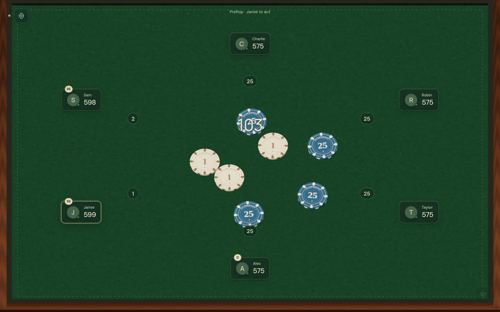
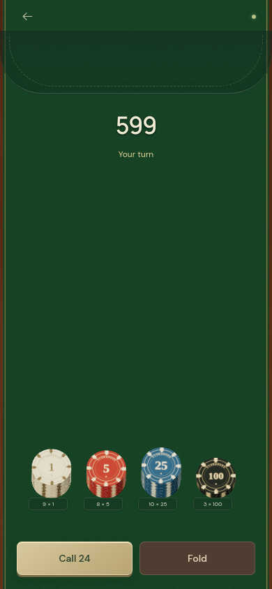

# Clubhouse

A shared chip table for physical poker. Your laptop displays the pot; phones around the table hold the chips. Bring your own playing cards.

Both playing surfaces use real 3D geometry and rigid-body physics: walnut rails, leather, woven green felt, solid printed chips, gravity, chip collisions, soft shadows, and throws from each seat. The laptop is a full-screen felt surface with host controls hidden behind the gear icon. Phones show stacks at the bottom and selected chips in the middle, with turn status and Check/Call and Fold buttons. Materials are generated locally; chip contacts use locally stored recordings from Kenney's CC0 Casino Audio pack. Devices without WebGL fall back to CSS chip and table surfaces.

## During a game

The laptop shows the pot, whose turn it is, and each player’s current bet. Phones hold the chips and show the actions available on that player’s turn.





## Start the table

Requires Node.js 20 or later.

```sh
npm install
npm start
```

Open **http://localhost:3000** on this laptop. Connect phones to the same Wi-Fi and scan the QR code in the sidebar. The server also prints the laptop’s local network addresses. Keep the laptop awake and the terminal running while playing.

If a phone cannot connect, use the address belonging to the laptop’s Wi-Fi interface, allow incoming connections on port 3000 in the laptop firewall, and check that your router does not isolate wireless clients. A phone hotspot also works when the laptop and other phones connect to it. Internet access is not needed after dependencies are installed; fonts and audio are served by the laptop.

For another port: `PORT=3001 npm start`.

## At the table

- Open the gear icon for invitations, the bank, settings, fullscreen, and practice mode. The trophy icon awards the pot. Set the starting stack under **Table settings**; new players receive 600 chips by default: four 100s, six 25s, eight 5s, and ten 1s. Choose 2–20 players when setting up a new table.
- Players choose an arc around the oval table matching their physical seat relative to the laptop.
- On a phone, tap a bottom stack to pick up one chip into the middle. A touched chip lifts above the others and follows the finger silently. It falls and collides when released; carrying it back to the bottom returns it. Two or more fingers carry all selected chips toward the pot to throw them, or back toward the bottom to return all of them. There are no Put back or Throw buttons. Thrown chips enter the laptop from the player’s seat direction.
- Start a two-or-more-finger drag in the bottom stacks area to lift the whole stack. Release at the top of the chip surface to go all in, including any selected chips. Releasing earlier or cancelling the touch returns the stack without placing a bet.
- **Exchange** appears when a denomination is empty and other stacked chips can provide change. Choose an equal-value swap; selected chips stay separate. Denominations are retained after betting and reloading.
- The laptop’s **Undo** button restores the last table action, with a maximum of two saved actions. Undo consumes history; a new action adds one new undo. Bets, calls, loans, folds, payouts, settings, joins, and removals can be undone.
- Chip counts above ten automatically exchange upward, starting with ones and continuing through fives and 25s. A denomination keeps at most ten chips; 100s have no limit.
- The laptop starts each hand, choosing the button (which defaults to rotating clockwise). Small and big blinds post automatically; the default blinds are 1/2 and can be changed between hands in settings. The button is also the small blind with two players.
- Only the player whose turn is highlighted may bet, raise, call, check, or fold. Preflop action starts after the big blind; later rounds start after the button. The big blind keeps the option to check or raise. Minimum raises, short all-ins, and reopening betting are enforced.
- Phones show equal-sized **Check/Call** and **Fold** buttons. Check appears when nothing is owed; Call shows the remaining amount for this betting round, capped at the player's stack. Both buttons are disabled while chips are selected or carried, and outside the player's turn. Return selected chips to the stacks to use either button.
- Each player's current-round contribution appears outside their name box toward the pot. These amounts disappear when betting closes. The laptop then offers **Deal flop**, **Deal turn**, or **Deal river**; advance after dealing the physical cards. After the river, select winners. If everyone else folds, the pot is awarded automatically.
- Folded chips remain in the pot and folded players cannot receive payouts. Use Undo to correct a fold or restore the previous turn.
- **Award the pot** calculates contribution tiers, lets the host choose each eligible winner, and supports split pots. Uncalled chips return to their contributor. Odd chips in a split are distributed clockwise from seat 1. Awarding all pots prepares the next hand; press **Start hand** after dealing.
- **The bank** gives or repays loans and keeps a debt record. Loans and repayments are available between hands. This keeps their side-pot eligibility correct.
- **Practice table** in the gear menu creates sample players and starts a hand with blinds. The phone icon opens a practice player’s surface. Start a fresh table from settings when ready to invite real players.

## Saving and reconnecting

Table state is stored in `.data/tables.json`; the server restores it after restarting. Host and player credentials are stored in each browser’s local storage, so refreshing or reconnecting preserves their seats. Do not clear browser storage during a game. A player removed by the host can join again at the next hand.

Chip inventories and pending actions are also retained in the phone's browser. A dropped live-update connection does not prevent submitting a move. Requests time out and retry with the same ID; reconnecting recovers an unanswered move without deducting chips twice.

After starting a fresh table, you can return to an earlier one under **Table settings → Your saved tables** in the same laptop browser.

The server is intended for a trusted local network. Keep host access on your laptop; share the player invitation link. Do not forward the port to the public internet. New tables have independent credentials. There is no login, payment, real-money processing, or cloud service.

## Verify

```sh
npm test
npm run check
```

The tests cover side pots, folded contributions, uncalled-chip refunds, split pots, odd chips, calls, loans, atomic payout validation, rigid-body gravity, collisions, table boundaries, and releasing held chips.

The browser smoke test uses local Google Chrome:

```sh
npx playwright test
```

To regenerate the README screenshots with local Chrome, start a separate empty server and run `DEMO_ORIGIN=http://localhost:3000 node scripts/capture-readme.mjs`. This creates a practice table in that server.
